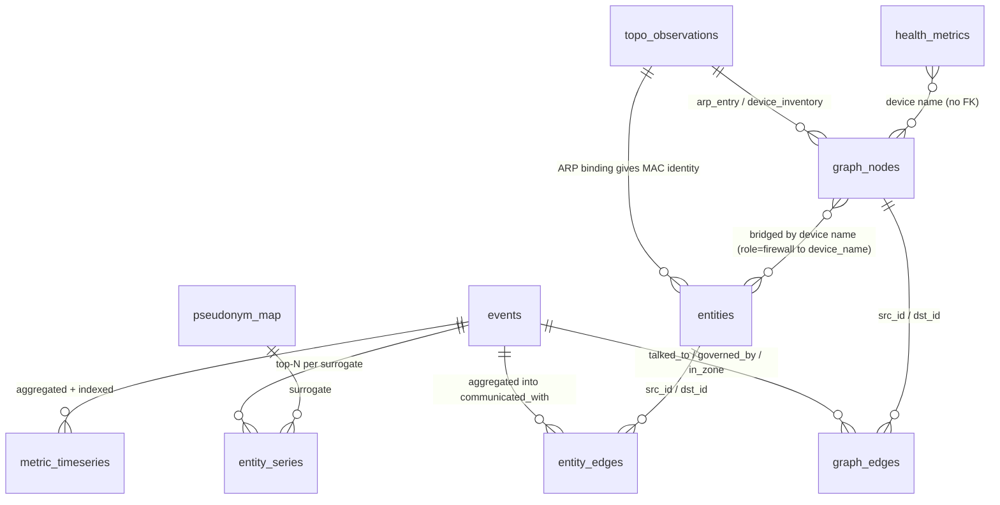

# SSDF data model

This is the full reference for every table, view, key, vocabulary and access grant in
the SSDF ClickHouse store (guest 701). The DDL lives in `infra/clickhouse/0NN_*.sql`
(migrations, applied in order). Vocabularies and row counts were checked live on
**2026-10-17**. For ingest samples, volumes and query patterns, see
[`data-modeling-faq.md`](data-modeling-faq.md).

---

## 1. Shape of the model

SSDF has four layers. Each layer is derived from the one above it and never writes
back up.

```
L0  WIRE       vendor syslog (SRX, Junos sys, PAN-OS, UniFi CEF, Proxmox)
               vendor MCP polls (ARP/inventory, rulebases, CPU/mem/alarms)
                    │  normalize at ingest (Vector VRL)      │ Python collectors
                    ▼                                        ▼
L1  FACTS      ssdf.events                ssdf.topo_observations   ssdf.health_metrics
               (append-only, MergeTree, 30d TTL, partitioned by day)
                    │  resolvers on guest 704 (5 min / hourly)
                    ▼
L2  GRAPHS     topology graph:  ssdf.graph_nodes ── ssdf.graph_edges
               entity graph:    ssdf.entities    ── ssdf.entity_edges
               (current state, ReplacingMergeTree keyed by stable 16-hex IDs)
                    │  public-metrics resolver (keyed HMAC pseudonyms)
                    ▼
L3  PUBLIC     ssdf_public.metric_timeseries   ssdf_public.entity_series
               ssdf_public.graph_nodes/edges (views, legacy M7b)
               ssdf.pseudonym_map (sovereign-only re-identification key)

    CROSS-CUTTING   ssdf.audit — one hash-chained row per MCP tool call
```

There are two separate graphs, and they answer different questions:

- **Topology graph** (`graph_*`): *where things are*. Hosts, devices, zones,
  addresses, and which host talked to which. It is built from `topo_observations`
  plus `events`.
- **Entity graph** (`entities`/`entity_edges`): *who the actors are and what governs
  them*. Assets keyed by identity (MAC first), firewalls, configured and observed
  policies, and aggregated communication edges that carry provenance.



There are **no enforced foreign keys** (ClickHouse has none). Joins go through stable
hashed IDs inside each graph, and through **device names** across graphs. That is why
`docs/naming-standard.md` is load-bearing: `JUNOS_DEVICES`, `observer_hostname`,
`graph_nodes.name` and `entities.identifiers['device_name']` must all spell a device
the same way.

---

## 2. Conventions that apply everywhere

| Convention | Rule |
|---|---|
| Time | Every timestamp is `DateTime64(3,'UTC')`, except the public metric buckets, which are `DateTime` (UTC). Compare against `parseDateTimeBestEffort({p:String})`. A raw ISO string with `+00:00` raises `TYPE_MISMATCH` |
| Tenant | Every table has `tenant_id LowCardinality(String) DEFAULT 't_main'`, and it is the first sort-key column. There is one tenant today. The column is a seam for later, not something in use |
| Enumerations | Stored as `LowCardinality(String)`, not as `Enum`, so adding a value is not a schema migration. The vocabularies below are enforced by producers, not by the database |
| Extensibility | Vendor- or kind-specific fields go in a `Map(String,String)` (`ext`, `attrs`, `identifiers`), not in new columns. Map keys carry a vendor prefix (`panw.panos.*`, `unifi.*`, `proxmox.*`, `junos.sys.*`) |
| Raw retention | Fact tables keep a `raw String` holding the original line or payload, redacted at ingest |
| IDs | Graph IDs are `sha1(text)[:16]` over a namespaced canonical key (§5), so they are deterministic and idempotent across resolver runs |
| Current state | Graph tables are `ReplacingMergeTree(last_seen)`: the newest version of a row wins **when parts merge**. Queries must use `FINAL` or deduplicate (`count(DISTINCT id)`, `argMax`) |
| Retention | 30-day TTL on every fact and graph table. 90 days on `audit`. `pseudonym_map` has no TTL. A graph row expires 30 days after its `last_seen`, so anything not seen for 30 days drops out of the graph |
| Privacy | Failed-login usernames are HMAC'd at ingest and secret-shaped config values are `[REDACTED]`, in both `raw` and `ext`. The public tier never sees a real identifier |

---

## 3. L1: fact tables

### 3.1 `ssdf.events`

This is the system of record for everything that arrives as a log. There is one row per
normalized event. DDL: `001_events.sql`, `006_observer_hostname.sql`.

- **Engine:** `MergeTree`
- **Partition:** `toYYYYMMDD(timestamp)`
- **Order:** `(tenant_id, timestamp, event_action)`
- **TTL:** 30 days
- **Size:** about 6.2M rows, 308 MiB on disk

| Column | Type | Meaning / vocabulary |
|---|---|---|
| `timestamp` | DateTime64(3,'UTC') | Event time, as reported by the device |
| `event_id` | String | Event identifier |
| `tenant_id` | LowCardinality(String) | `t_main` |
| `event_kind` | LowCardinality(String) | `event` \| `alert` |
| `event_category` | Array(LowCardinality(String)) | One or more of `network`, `intrusion_detection`, `authentication`, `configuration`, `host` |
| `event_action` | LowCardinality(String) | Verb families: `flow_*`, `auth_*`, `configuration_*`, `config_*`, `screen_*`, `threat_*`, `system_*`, `task_*`, `task_end_*`, `alert_*`, `rt_*` (fallback); plus `unknown`/`parse_error` |
| `event_outcome` | LowCardinality(String) | `success` \| `failure` \| `detection` \| `unknown` |
| `event_provider` | LowCardinality(String) | `juniper` \| `paloalto` \| `unifi` \| `proxmox` |
| `observer_hostname` | LowCardinality(String) | Short name of the **firewall that logged the event** (gated to the known fleet; original case kept). `''` for unknown or non-firewall sources |
| `source_ip` / `destination_ip` | Nullable(IPv4) | IPv4 only. IPv6 peers stay null and go into `ext` |
| `source_port` / `destination_port` | Nullable(UInt16) | |
| `source_bytes` / `destination_bytes` / `network_bytes` | Nullable(UInt64) | Client→server bytes, server→client bytes, and their total |
| `network_transport` | LowCardinality(String) | `tcp`, `udp`, `icmp`, … |
| `rule_name` | String | The policy or rule that matched |
| `observer_ingress_zone` / `observer_egress_zone` | LowCardinality(String) | Firewall zones |
| `user_name` | String | Plaintext for successful or admin actions, `HMAC-SHA256` hex for failed logins, `''` when absent |
| `ext` | Map(String,String) | Vendor-only fields (§3.1.1) |
| `raw` | String | Original line after redaction |

**Main `event_action` values by provider** (30-day live counts are in the FAQ):

| Provider | Actions |
|---|---|
| juniper (security, 514) | `flow_session_create`, `flow_session_close`, `flow_session_deny`, `screen_<attack>` (alert), `rt_<msgid>` fallback |
| juniper (system, 514/518) | `auth_success`, `auth_failure`, `auth_login`, `auth_logout`, `auth_event`, `auth_attempts_threshold`, `configuration_change`, `configuration_commit`, `configuration_commit_completed` |
| paloalto | `flow_start`, `flow_end`, `flow_deny`, `threat_<subtype>`, `system_<subtype>`, `config_<cmd>`, plus a generic fallback for URL, WILDFIRE, DATA, TUNNEL, AUTH and DECRYPTION logs |
| unifi | `alert_<policy-name-slug>` (for example `alert_scanning-activity`) |
| proxmox | `auth_success`, `auth_failure`, `task_<type>`, `task_end_<type>` |

#### 3.1.1 `ext` key namespaces

| Prefix | Source | Notable keys |
|---|---|---|
| *(bare SD names)* | SRX `RT_*` | `session-id-32`, `session-id`, `application`, `application-sub-category`, `src-vrf`, `packet-incoming-interface`, … (also repeats some typed columns, see FAQ §2 #3) |
| `junos.sys.*` | Junos system log | `msgid`, `commit_message`, `pathname`, `data`, `value`, `limit` |
| `panw.panos.*` | PAN-OS | `session_id`, `session_end_reason`, `subtype`, `application`, `severity`, `threat_id`, `category`, `direction`, `command`, `client`, `result`, `uuid` |
| `unifi.*` / `unifi.ips.*` | UniFi CEF | `src_mac`, `dst_mac`, `src_alias`, `device_name`, `device_ip`, `session_id`, `direction`; `ips.signature`, `ips.signature_id`, `ips.severity`, `ips.risk`, `ips.category`, `ips.action`, `ips.app_proto`, `ips.policy_type` |
| `proxmox.*` | Proxmox | `node`, `upid`, `vmid`, `task_type`, `task_status`, `realm`, `appname`, `invalid_user` |

### 3.2 `ssdf.topo_observations`

Raw topology facts polled from devices through vendor MCPs. There is one row per fact
per collector pass. These rows are the input to the topology graph and to MAC-based
asset identity. DDL: `002_topology.sql`.

- **Engine:** `MergeTree`
- **Partition:** by day
- **Order:** `(tenant_id, collector, observed_at)`
- **TTL:** 30 days
- **Size:** about 692k rows

| Column | Type | Meaning |
|---|---|---|
| `observed_at` | DateTime64(3,'UTC') | Poll time |
| `collector` | LowCardinality | `junos` \| `panos` |
| `source_device` | String | Device that reported the fact (short name) |
| `layer` | LowCardinality | `l2` \| `l3` |
| `observation_type` | LowCardinality | `arp_entry` (subj `host` IP → obj `host` MAC, `attrs.interface`) \| `device_inventory` (subj `device`, `attrs.role`, `attrs.name`) |
| `subj_kind` / `subj_id` | | Subject of the fact |
| `obj_kind` / `obj_id` | | Object of the fact (empty for unary facts) |
| `attrs` | Map | Per-type attributes |
| `raw` | String | Collector payload excerpt |

### 3.3 `ssdf.health_metrics`

Operational gauges in entity-attribute-value form, with one row per (device, metric,
sensor, timestamp). A new sensor or metric adds rows, not columns. DDL:
`014_health_metrics.sql`.

- **Engine:** `MergeTree`
- **Partition:** by day
- **Order:** `(tenant_id, provider, device, metric_class, sensor, timestamp)`
- **TTL:** `HEALTH_TTL_DAYS` (default 30)

| Column | Type | Meaning |
|---|---|---|
| `timestamp` | DateTime64(3,'UTC') | Poll time |
| `provider` | LowCardinality | `juniper` \| `paloalto` (proxmox and unifi collectors exist but write no rows today) |
| `device` | LowCardinality | Device name; the same spelling as the topology and policy tables |
| `scope` | LowCardinality | `device` (default); `guest`/`node` are reserved for Proxmox |
| `metric_class` | LowCardinality | `cpu` \| `memory` \| `temperature` \| `alarm` |
| `sensor` | LowCardinality | Sensor name for multi-sensor classes; `''` otherwise |
| `metric_name` | LowCardinality | `cpu_util_pct`, `mem_util_pct`, `active_alarm_count`, `alarm`, … |
| `metric_value` | Float64 | Typed value |
| `unit` | LowCardinality | `percent`, `count`, `celsius` |
| `raw` | String | Payload excerpt |

Live coverage: Juniper reports `cpu` and `alarm` for 23 devices; PAN-OS reports `cpu`
and `memory`. There are no Juniper memory rows and no temperature rows today.

---

## 4. L2: graph tables

All four graph tables use `ReplacingMergeTree(last_seen)` ordered by
`(tenant_id, <id>)`, with a TTL of 30 days after `last_seen`. The resolvers write
rows; queries need `FINAL`.

### 4.1 Topology graph: `ssdf.graph_nodes` / `ssdf.graph_edges`

Written by the topo resolver (`services/topo`) every 5 minutes, as user `ssdf_topo`.
DDL: `002_topology.sql`.

**`graph_nodes`**: `node_id, tenant_id, kind, name, identifiers Map, first_seen, last_seen, attrs Map`

| `kind` | `identifiers` | `attrs` | Live rows | Notes |
|---|---|---|---|---|
| `host` | `ip`, `mac` | `unresolved` | 1,321 | Endpoint seen in ARP or flows |
| `device` | `name` | `role` | 24 | Network device. `role=firewall` is what `enforcement_points` selects |

**`graph_edges`**: `edge_id, tenant_id, src_id, dst_id, edge_type, layer, first_seen, last_seen, confidence Float32, attrs Map`

| `edge_type` | `layer` | `attrs` | Meaning |
|---|---|---|---|
| `talked_to` | `flow` | `bytes`, `flows`, `provider`, `evidence` | host → host traffic, from events |
| `governed_by` | `flow` | `rule_name`, `evidence` | flow → the rule that matched |
| `in_zone` | `flow` | `zone`, `evidence` | host → firewall zone |
| `has_address` | `l3` | `ip`, `evidence` | ARP binding of MAC to IP |

`load_subgraph` derives nodes **from edges**, so nodes with no edges (a firewall's
`device_inventory` entry) are invisible to it. Inventory-style questions must read
`graph_nodes FINAL` directly.

### 4.2 Entity graph: `ssdf.entities` / `ssdf.entity_edges`

Written by the entity resolver (5 minutes, user `ssdf_entity`) and the policy resolver
(hourly, also `ssdf_entity`). `reconcile_assets` runs as `ssdf_entity_maint`, the only
role that is meant to delete rows. DDL: `004_entities.sql`.

**`entities`**: `entity_id, tenant_id, kind, name, identifiers Map, source, identity_basis, confidence Float32, attrs Map, first_seen, last_seen`

| `kind` | `source` | `identity_basis` | Canonical key → `entity_id` | `identifiers` | `attrs` | Live |
|---|---|---|---|---|---|---|
| `asset` | observed | `mac` (confidence 1.0) | `mac:<mac>` | `mac`, `ip` | — | ┐ 606 |
| `asset` | observed | `ip_only` (confidence 0.5) | `ip:<segment>:<ip>` | `ip` | — | ┘ |
| `firewall` | configured | `device_name` | `device:<name>` | `device_name` | `provider`, `rule_count` | 19 |
| `policy` | configured | — | `<provider>:<device_name>:<rule_name>` | `provider`, `device_name`, `rule` | `position`, `action`, `enabled`, `from_zone`, `to_zone`, `source_addresses`, `dest_addresses`, `application`, `service`, `provider`, `device_name`, `panw.panos.uuid` | 65 |
| `policy` | observed | — | rule seen in flow logs | `provider`, `rule` | `provider` | 6 |
| `identity` | — | — | reserved, not populated | | | 0 |

**`entity_edges`**: `edge_id, tenant_id, src_id, dst_id, edge_type, source, confidence Float32, attrs Map, first_seen, last_seen`

| `edge_type` | `source` | src → dst | `attrs` | Live |
|---|---|---|---|---|
| `communicated_with` | observed | asset → asset | `bytes`, `sessions`, `ports`, `transports`, `providers`, `observer_hosts` (comma-separated set of logging firewalls) | 605 |
| `governed_by` | observed | asset-pair → observed policy | `provider`, `rule` | 578 |
| `governed_by` | configured | firewall → configured policy | `provider`, `rule` | 65 |
| `authenticated_as` | — | asset → identity | reserved | 0 |

**Identity rules for assets:**

- **The MAC is the identity, and an IP is an observation tied to one segment.**
- When an ARP binding (from `topo_observations`, 168-hour lookback, most recent
  binding wins) maps (segment, IP) to a MAC, the asset key is `mac:<mac>`. Otherwise it
  is `ip:<segment>:<ip>`.
- The segment is `normalize_segment(observer_hostname)`: the first DNS label,
  lowercased.
- The same IP with a different MAC in one segment sets an `ip_conflict` flag and is
  never merged. The same IP in different segments stays two assets, because of NAT and
  address reuse.
- `communicated_with` is keyed on entity IDs, so two IPs that resolve to one MAC
  share an edge.
- Lookups order by `confidence DESC, last_seen DESC`, so a MAC-keyed asset beats a
  stale IP-only twin.

**Joining the two graphs:** `explain_access` matches a flow edge's `observer_hosts`
(provenance) first, normalized with `_short_host`, against
`entities.identifiers['device_name']`. If there is no match it falls back to
topology: `graph_nodes` where `kind='device' AND attrs['role']='firewall'`, matched
by name.

---

## 5. Stable ID derivation

| ID | Formula (sha1 hex, first 16 characters) | Code |
|---|---|---|
| `graph_nodes.node_id` | `sha1("{tenant}\|{kind}\|{canonical_key}")` | `services/topo/src/ssdf_topo/models.py` |
| `graph_edges.edge_id` | `sha1("{tenant}\|{src}\|{dst}\|{edge_type}\|{layer}")` | same |
| `entities.entity_id` | `sha1("{tenant}\|entity\|{kind}\|{canonical_key}")` | `ssdf_entity/models.py`, `ssdf_policy/models.py` |
| `entity_edges.edge_id` | `sha1("{tenant}\|entity_edge\|{src}\|{dst}\|{edge_type}\|{source}")` | same |

These IDs are deterministic, so a re-run produces a new **version** of the same row,
which ReplacingMergeTree collapses. They are not natural keys: to filter, use
`identifiers['device_name']` and the other identifier keys, not `entity_id`.

---

## 6. L3: public and de-identified tables

### 6.1 `ssdf_public.metric_timeseries`

Aggregate time series. This is the main surface of the public tier. Written about
every 5 minutes by `services/public-metrics` (user `ssdf_pubmetrics`). DDL:
`013_public_metrics.sql`.

`bucket_start DateTime, metric, dim, value Float64, tenant_id, inserted_at DateTime`

- **Engine:** `ReplacingMergeTree(inserted_at)`
- **Order:** `(tenant_id, metric, dim, bucket_start)`
- **TTL:** 30 days

| `metric` | Tier | Definition |
|---|---|---|
| `bytes`, `flows`, `connections` | 1 (volume) | Sums over `event_action LIKE 'flow_%'` |
| `deny_rate_index` | 2 (stance) | Deny ratio relative to baseline, no absolute counts |
| `ips_volume_index` | 2 (stance) | IPS alert volume relative to baseline |
| `mem_util_pct`, `cpu_util_pct`, `iface_error_rate`, `port_flap_count`, `proto_flap_count` | 3 (health) | Defined in `measures.py` but **disabled** |

`dim` is `''` (fleet-wide) for every live metric. The catalog is declarative
(`services/public-metrics/.../measures.py`), so adding a measure means adding a catalog
entry, not changing the schema.

### 6.2 `ssdf_public.entity_series`

Per-host series under surrogate names, top-N only, `bytes` only today (37 surrogates).

`bucket_start, surrogate, metric, value, tenant_id, inserted_at`

- **Engine:** ReplacingMergeTree
- **Order:** `(tenant_id, metric, surrogate, bucket_start)`

### 6.3 `ssdf.pseudonym_map` (sovereign only)

`kind, real_value, surrogate, key_version UInt16, first_seen, last_seen`

- **Engine:** `ReplacingMergeTree(last_seen)`
- **Order:** `(kind, real_value, key_version)`
- **TTL:** none

The surrogate is `HMAC-SHA256(key, value)`, with a per-kind prefix (`h_` for hosts),
10 hex characters, made longer on a collision. The key lives only on guest 704.
`key_version` allows key rotation. Read by `reidentify` (sovereign) and **never
granted to `ssdf_public`**. 148 `host` rows today.

### 6.4 `ssdf_public.graph_nodes` / `graph_edges` (views, legacy M7b)

`SQL SECURITY DEFINER` views over the topology graph. They replace every ID with
`hex(sipHash128Keyed(k, id))` (key in `ssdf.view_pseudonym_key`) and drop `name`,
`identifiers` and `attrs`. They still exist and are still granted, but the M7c
classification lockdown means no public tool reads them.

---

## 7. Cross-cutting: `ssdf.audit`

One row per MCP tool call, including denied calls. Tamper-evident. DDL: `007`, `009`,
`016`, `017`.

- **Engine:** MergeTree
- **Order:** `(ts, principal)`
- **TTL:** 90 days
- `non_replicated_deduplication_window=10000`

| Column | Meaning |
|---|---|
| `ts` | Call time |
| `principal` | Authenticated token name (for example `agent`, `eval-qwen`) |
| `tier` | `sovereign` \| `public` \| `evidence` (rows from the external mecmcp evidence ledger) |
| `tool` | Tool name (`evidence:*` for ledger rows) |
| `args` | JSON of the call arguments |
| `data_classes` | Classes the tool can return: `security_log`, `topology`, `identity`, `firewall_config`, `metrics` |
| `decision` | `allow` \| `deny` (forbidden, expired or rate-limited) \| ledger states (`approved`, …) |
| `row_count`, `error` | Outcome |
| `prev_hash`, `row_hash` | Hash chain per tier: `row_hash = SHA256(prev_hash + canonical(row))` |
| `client_name` | **Asserted by the client** (MCP `clientInfo`). Not trustworthy |
| `model_id`, `actor_type` | **Declared by the operator** in the token file. `actor_type` ∈ human \| agent \| unknown |

Contract: `docs/audit-evidence-contract-v1.md`. Verifier:
`python -m ssdf_mcp_query.verify_audit`.

---

## 8. Access model (who can read and write what)

The ClickHouse users are the hard boundary. MCP tool classification is enforced on top
of them.

| User | Used by | Reads | Writes |
|---|---|---|---|
| *(Vector)* | ingest (guest 700) | — | `events`, `host_logs`, `host_log_lines` |
| `ssdf_topo` | topo resolver | `events`, `topo_observations`, `graph_*` | `topo_observations`, `graph_nodes`, `graph_edges` |
| `ssdf_entity` | entity + policy resolvers | `events`, `topo_observations`, `graph_nodes`, `entities`, `entity_edges` | `entities`, `entity_edges` |
| `ssdf_entity_maint` | `reconcile_assets` | `topo_observations`, `entities`, `entity_edges` | the same two tables, plus `ALTER DELETE` |
| `ssdf_health` | health poller | — | `health_metrics` |
| `ssdf_pubmetrics` | public-metrics resolver | `events`, its own outputs | `metric_timeseries`, `entity_series`, `pseudonym_map` |
| `ssdf_ro` | sovereign MCP (guest 702), incl. `run_sql` | `events`, `topo_observations`, `graph_*`, `entities`, `entity_edges`, `health_metrics`, `pseudonym_map`, `host_logs`, `host_log_senders`, `ssdf_public.*` | — (`readonly=1`, capped time, rows and memory) |
| `ssdf_public` | public MCP (guest 703) | `ssdf_public.*` **only** | — |
| `ssdf_view_definer` | public views | `graph_*`, `view_pseudonym_key` | — |
| `ssdf_audit` | both MCP tiers | — | `audit` (insert only) |
| `ssdf_audit_verify` | offline verifier | `audit` | — |

`005` granted `ALTER DELETE` to `ssdf_entity`; `011` revokes it, so only
`ssdf_entity_maint` can delete rows (checked live on 2026-10-17).

---

## 9. Lineage summary

| Target | Built from | By | Cadence |
|---|---|---|---|
| `events` | syslog UDP 514–518 | Vector VRL | streaming |
| `topo_observations` | Junos/PAN-OS MCP (ARP, inventory) | `ssdf_topo.collect_all` | 5 min |
| `graph_nodes/edges` | `topo_observations` + `events` | `ssdf_topo.resolve_main` | 5 min |
| `entities` (asset), `entity_edges` (`communicated_with`, observed `governed_by`) | `events` (flow aggregation) + ARP bindings | `ssdf_entity.resolve_main` | 5 min |
| `entities` (firewall, configured policy), configured `governed_by` | vendor rulebases via MCP | `ssdf_policy.collect_resolve` | hourly |
| `health_metrics` | vendor MCP op-commands | `ssdf_health.collect_main` | 5 min |
| `metric_timeseries`, `entity_series`, `pseudonym_map` | `events` | `ssdf_public_metrics` | about 5 min |
| `audit` | MCP tool calls | `wrapper.audited_tool` | per call |

---

## 10. Known modeling debts

These are open questions for the data team, and they repeat FAQ §2:

1. IPv4-only address columns. IPv6 goes into `ext`.
2. No typed MAC columns in `events`, so UniFi detections (MAC-only) can't join assets.
3. SRX `ext` repeats typed columns.
4. `raw` makes up most of the bytes in `events`.
5. A single wide `events` table mixes flows, alerts, auth and config, and its sort key
   does not support lookups by IP or device.
6. The `identity` entity kind and the `authenticated_as` edge are reserved but have no
   data. User↔asset binding needs an identity source (IdP, NAC).
7. Device names are the cross-graph join key, with no registry table. A `devices`
   dimension table would make the joins explicit.
8. Health covers Juniper and PAN-OS only, and Tier-3 public health metrics are
   disabled.
